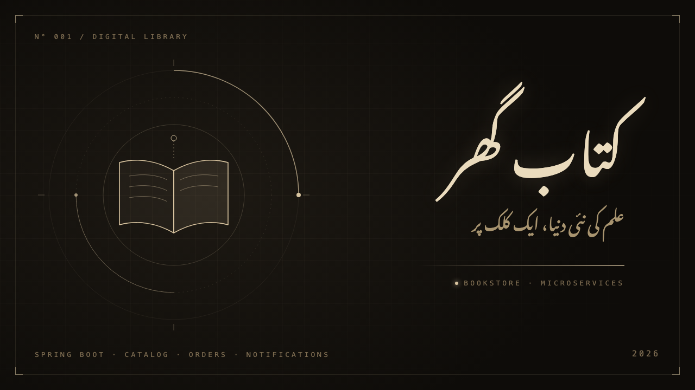
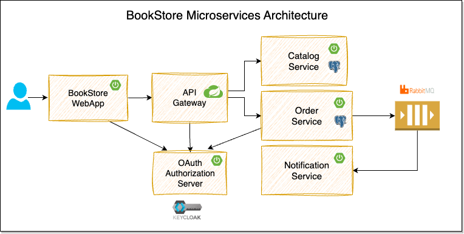

# Kutub Khanah

This repository contains the source code for the [Kutub Khanah](https://www.youtube.com/playlist?list=PLuNxlOYbv61g_ytin-wgkecfWDKVCEDmB).



We will build a BookStore application using Spring Boot, Spring Cloud, and Docker.



## Tech Stack & Versions

| Software                        | Version                    |
| ------------------------------- | -------------------------- |
| Java                            | 21 (GraalVM CE 21.0.2)     |
| Maven                           | 3.9.16 (via Maven Wrapper) |
| Spring Boot                     | 4.1.1                      |
| Spring Framework                | 7.0.9                      |
| Spring Data JPA                 | 4.1.1                      |
| Hibernate ORM                   | 7.4.5                      |
| Flyway                          | 12.4.0                     |
| PostgreSQL                      | 18.1                       |
| springdoc-openapi               | 3.1.1                      |
| Testcontainers                  | 2.0.5                      |
| JUnit Jupiter                   | 6.0.3                      |
| RestAssured                     | 6.1.0                      |
| AssertJ                         | 3.27.7                     |
| Spotless (Palantir Java Format) | 3.10.4 (2.102.0)           |

## Modules

- **backend-catalog-service**:
  This service provides REST API for managing catalog of products(books).

    **TechStack:** Spring Boot, Spring Data JPA, Flyway, PostgreSQL

The following modules are planned and not implemented yet:

- **order-service**:
  This service provides the REST API for managing orders and publishes order events to the message broker.

    **TechStack:** Spring Boot, Spring Security OAuth2, Keycloak, Spring Data JPA, PostgreSQL, RabbitMQ

- **notification-service**:
  This service listens to the order events and sends notifications to the users.

    **TechStack:** Spring Boot, RabbitMQ

- **api-gateway**:
  This service is an API Gateway to the internal backend services (catalog-service, order-service).

    **TechStack:** Spring Boot, Spring Cloud Gateway

- **bookstore-webapp**:
  This is the customer-facing web application where customers can browse the catalog, place orders, and view their order details.

    **TechStack:** Spring Boot, Spring Security OAuth2, Keycloak, Thymeleaf, Alpine.js, Bootstrap

## Learning Objectives

- Building Spring Boot REST APIs
- Database Persistence using Spring Data JPA, Postgres, Flyway
- Event Driven Async Communication using RabbitMQ
- Implementing OAuth2-based Security using Spring Security and Keycloak
- Implementing API Gateway using Spring Cloud Gateway
- Implementing Resiliency using Resilience4j
- Job Scheduling with ShedLock-based distributed Locking
- Using RestClient, Declarative HTTP Interfaces to invoke other APIs
- Creating Aggregated Swagger Documentation at API Gateway
- Local Development Setup using Docker, Docker Compose and Testcontainers
- Testing using JUnit, RestAssured, Testcontainers, Awaitility, WireMock
- Building a Web Application using Thymeleaf, Alpine.js, Bootstrap
- Monitoring & Observability using Grafana, Prometheus, Loki, Tempo

## Local Development Setup

- Install Java 21. Recommend using [SDKMAN](https://sdkman.io/) for [managing Java versions](https://youtu.be/ZywEiw3EO8A).
- Install [Docker Desktop](https://www.docker.com/products/docker-desktop/)
- Install [IntelliJ IDEA](https://www.jetbrains.com/idea) or any of your favorite IDE
- Install [Taskfile](https://taskfile.dev/) utility
- Install [Postman](https://www.postman.com/) or any REST Client

The project contains a `.sdkmanrc` file, so SDKMAN can install the exact Java and Maven versions for you:

```shell
$ curl -s "https://get.sdkman.io" | bash
$ source "$HOME/.sdkman/bin/sdkman-init.sh"
$ cd kutubkhanah
$ sdk env install    # installs java 21.0.2-graalce and maven 3.9.16
$ brew install go-task
(or)
$ go install github.com/go-task/task/v3/cmd/task@latest
```

Verify the prerequisites

```shell
$ java -version
$ docker info
$ docker compose version
$ task --version
```

### How to run the application locally?

```shell
# Clone the repository:
$ git clone https://github.com/shahhayat/kutubkhanah.git
$ cd kutubkhanah
```

#### Option 1: Start the infra components using Docker Compose and run microservices from IDE

1. **Start the required services (PostgreSQL):** `$ task start_infra`

2. **Start the catalog service:**
   Run the main entrypoint class `BackendCatalogServiceApplication` from your IDE.

3. **Access the application** at http://localhost:8081

- Catalog Service PostgreSQL DB: `jdbc:postgresql://localhost:15432/kutubkhanah` with credentials `postgres/postgres`

#### Option 2: Working on individual microservices

Each microservice has Testcontainers based configuration to start the required services such as PostgreSQL automatically.

You can start the catalog service by running its Test main entrypoint class `TestBackendCatalogServiceApplication` from your IDE.

#### Option 3: Run all the infra components and applications using Docker Compose

1. **Start all:** `$ task start`

2. **Access the application** at http://localhost:8081

3. **Stop all:** `$ task stop`

### Useful URLs (catalog service)

- Products API: http://localhost:8081/api/products
- Swagger UI: http://localhost:8081/swagger-ui.html
- Actuator: http://localhost:8081/actuator

### Run the tests

Docker must be running, because the tests use Testcontainers.

```shell
$ task test
```

## Other Learning Resources
